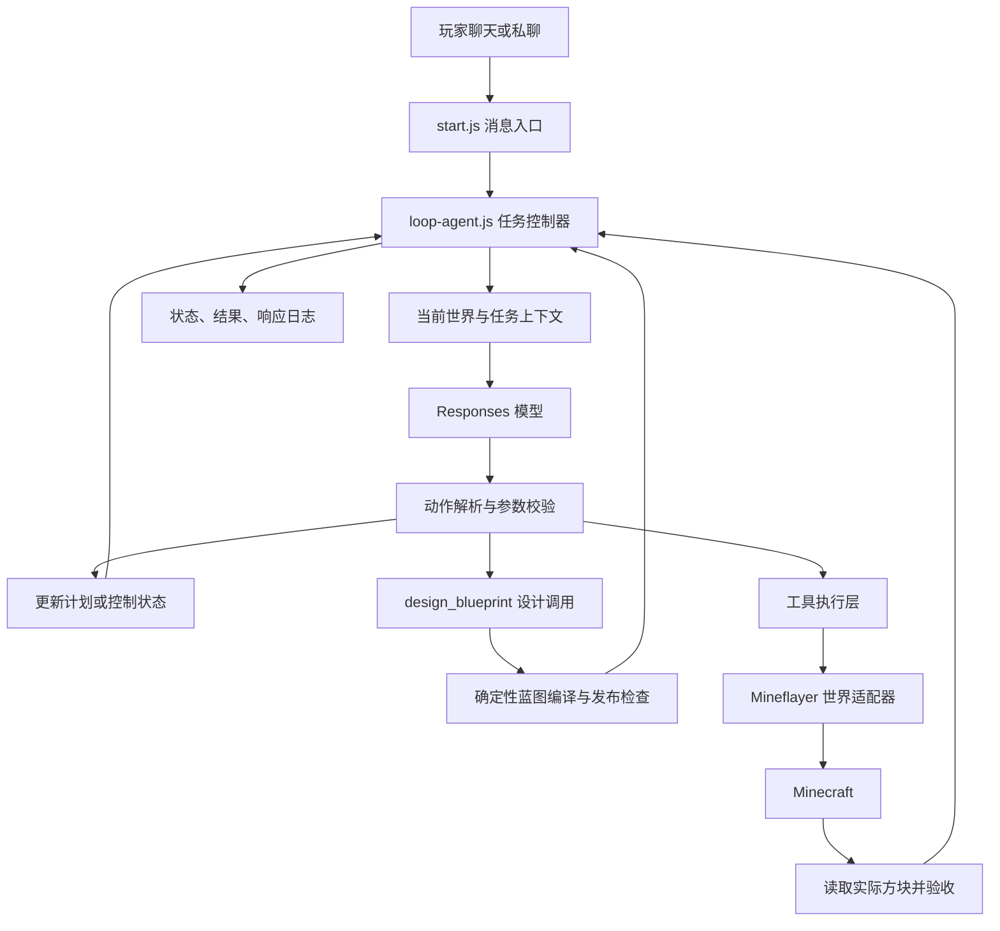
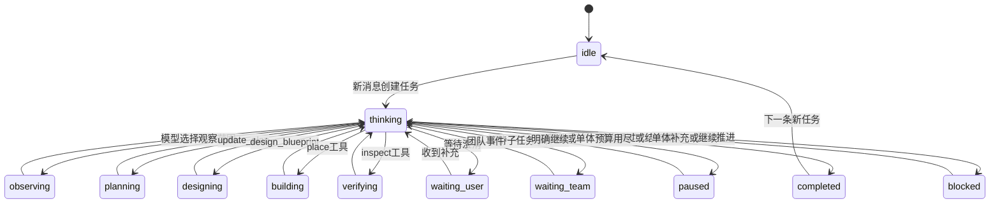
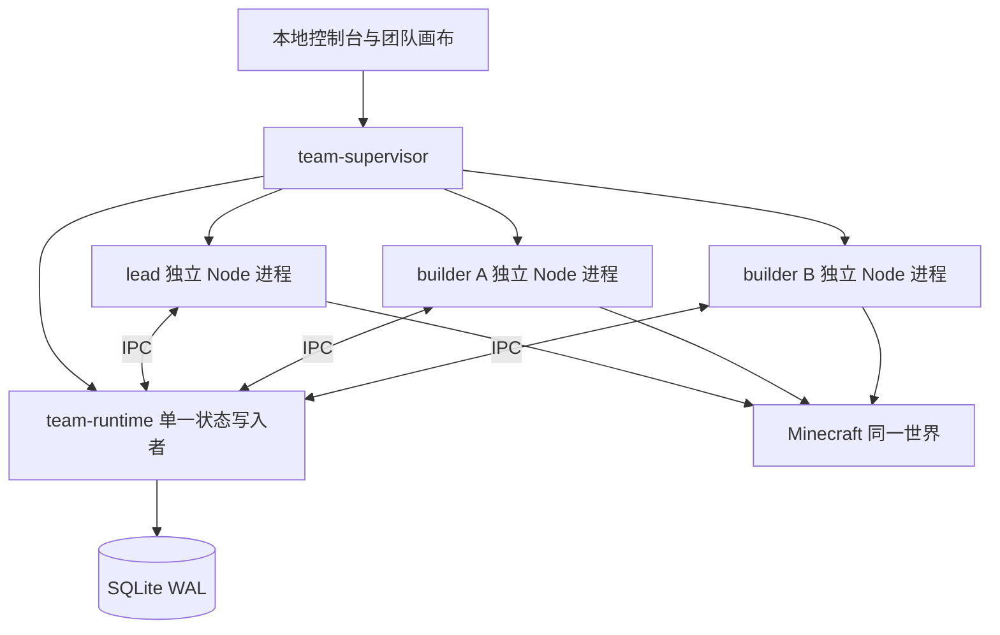

**Mindcraft Agent 系统详细逻辑分析**

分析日期：2026-11-15。依据：当前工作区源码，Git 基线 `27dc14e`，以及本地 `settings.js`、`andy.json` 的非密钥配置。已同步随后实施的“模型自主选择观察范围”改动，并通过完整离线回归。本说明不包含密钥内容；未连接 Minecraft 或调用真实模型 API，不代表真实游戏复测结果。

**1. 系统定位与实际入口**

当前默认系统是一个面向 Minecraft 创造模式建筑任务的、可持久化的“观察—计划—行动—检查”循环。模型选择下一步，程序执行有边界的工具并核验结果。它同时支持聊天、建造、显式拆除，以及通过控制台启动的多 Agent 协作。

仓库里存在两条不同的 Agent 路径，分析时必须区分：

| 路径 | 地位 | 主要机制 |
|---|---|---|
| `main.js → src/building/start.js → loop-agent.js` | 当前默认执行路径 | JSON 动作/原生函数、结构化计划、蓝图、确定性工具、现场验收 |
| `src/mindcraft/ → src/process/ → src/agent/agent.js` | 保留的旧版通用系统 | 对话生成 `!command`、技能库、可选动态代码、自然语言记忆、自提示 |

`npm start` 和 `Start-Mindcraft.cmd` 最终都执行 `main.js`。它只调用 `startBuildingAgent()`，没有启动旧版 MindServer 或旧 `Agent` 类。新版会复用旧目录中的 `creative_items.js` 作为底层兼容适配，但这不意味着旧版控制循环也在运行。



主模型决定的是“下一步应做什么”；执行层决定的是“这个动作是否合法、如何落实到游戏操作、实际是否成功”。蓝图是目标约束与验收依据，不是自动执行整栋建筑的脚本。

**2. 当前配置与配置生效范围**

| 项目 | 当前本地值或规则 |
|---|---|
| 默认机器人名 | `ZhiXiu`，来自 `andy.json` |
| 模型适配器 | `course_responses` |
| 模型标识 | `glm-5.3`；这是请求中发送的模型 ID，不据此推断网关内部实现 |
| 推理参数 | `reasoning.effort = high` |
| 输出参数 | `max_output_tokens = 4096`，`text.format.type = json_object` |
| 游戏版本 | Minecraft Java `1.21.6` |
| 游戏连接 | `127.0.0.1`，`offline`；端口优先使用 `MINECRAFT_PORT`，否则为 `settings.port = 51234` |
| 每轮预算 | 最多 500 次模型请求、240 分钟；主循环决策和设计 skill 共享次数预算 |
| 函数缺省预算 | 调用者未传参数时是 30 次、20 分钟；当前启动器已用 settings 覆盖 |
| 当前决策协议 | JSON action；由 `api` 适配器决定，不由模型名称决定 |

配置优先级：机器人名是 `--name → profile.name → builder`；profile 是 `--profile → settings.profiles[0]`；单进程默认只读取 profiles 数组第一项，不会因为数组列出多个 profile 就自动启动多个 Agent。

密钥由 `src/utils/keys.js` 获取：先取本地配置中的对应键，缺失时再取同名环境变量。Course 使用 `COURSE_API_KEY`，DeepSeek 使用 `DEEPSEEK_API_KEY`。密钥只参与模型客户端鉴权，不进入决策上下文。

`settings.js` 中保留了很多旧系统参数。`base_profile`、`load_memory`、`init_message`、`max_messages`、`max_commands`、`explicit_task_planning`、`allow_insecure_coding`、`allow_vision`、`mindserver_port` 等，并不直接控制当前 building 循环。特别是：当前新循环始终具有自己的计划机制；开启旧版 coding 开关，不会让新循环获得 `!newAction`。

**3. 从启动到就绪**

`startBuildingAgent()` 按以下顺序工作：

1. 解析 `--profile`、`--name`、`--resume`、`--help`；如有恢复文件，读取任务状态。
2. 加载 profile，校验 Minecraft 名称格式和端口。
3. 创建 Mineflayer bot，加载 pathfinder，注册错误、断开、死亡和重生事件。
4. 创建延迟初始化的模型封装；真正发请求时才实例化适配器。
5. bot 出生后，创建世界适配器、通信接口、任务持久化函数与循环控制器。
6. 若有 `MINDCRAFT_TEAM_SPEC`，使用 IPC 团队客户端；否则使用单 Agent/兼容通信路径。
7. 如有恢复状态，装入控制器，但不会立即恢复施工。
8. 发一次独立 API 测试，请求返回 `{"status":"ok"}`，最多等 60 秒。这个请求会产生独立用量，不计入某个建筑任务。
9. API 测试结束后挂接团队客户端并报告就绪；失败时机器人仍保持在线，后续消息可再次触发模型请求。

断开、死亡或重生会请求暂停。当前建筑启动器没有旧 `AgentProcess` 的自动重启循环；团队进程退出后的任务恢复由共享运行时处理，进程本身不等同于自动重新启动。

**4. 消息进入系统后的分流**

消息入口监听 Mineflayer 的 `chat` 和 `whisper`。

首先过滤自己发送的消息，以及不在 `only_chat_with` 白名单中的玩家。托管团队会过滤成员的游戏聊天，Agent 间消息走 IPC；非入口成员不处理普通公共任务消息，用户应向入口 lead 提交整体目标。

`parseBuildMessage()` 主要进行协议分流，不靠“建造”等关键词判断语义：

| 输入 | 处理方式 |
|---|---|
| `进度`、`查询进度`、`!plan` 等 | 直接读取控制器摘要，不调用模型 |
| `暂停`、`暂停建造` 等 | AbortController 请求中止当前回合并保存 |
| `继续`、`继续建造` 等 | 恢复当前可恢复任务 |
| `取消`、`取消建造` 等 | 终止当前任务；之后可提交新任务 |
| `!build at x y z 描述` | 解析明确施工原点并锁定 |
| 其他非空文本 | 进入 Agent，由模型判断聊天、澄清或任务执行 |

可去除消息开头的机器人名字或 `@名字`。控制词是整条消息匹配；复杂自然语言仍由模型处理。

候选场地选择：有明确坐标则使用它；否则以可见玩家的 `floor(x)+6, floor(y), floor(z)` 为锚点寻找地面。玩家不可见、地形无法确认或候选位置不合法时，保留 `siteIssue`，以机器人当前位置作为临时原点。普通聊天可以继续，但设计前必须解决选址问题。候选原点与机器人的距离检查为 256 格。

任务控制器对消息还有第二层分流：

- 没有任务，或上一任务 completed/cancelled/failed：创建新的 job。
- 正在执行：追加到 `messages`，真实用户补充还进入独立持久化的 `clarifications`，递增 `inputRevision`。
- waiting_user / waiting_team / blocked：收到用户补充会重新运行。
- paused：只保存补充，不自动调用模型，须明确发送“继续”。
- 未结束任务中的新文本默认是补充，不自动排队成独立新任务；换任务需要先取消。

`inputRevision` 用于拒绝过时决策：请求发出时保存版本，返回后若用户已补充要求，就保存原响应但不执行旧决策，重新构造上下文。它不是所有物理操作的即时回滚机制；已开始的工具/批次可能继续，明确暂停才会触发 abort。

兼容 peer 消息不会进入用户约束集合，也不增加用户修订号。托管团队事件使用另一套 `teamEventRevision` 和事件 ID 去重，主要用于刷新上下文和唤醒等待；生命周期事件自 2026-11-15 起进入 `teamFeed` 动态流而非聊天窗口。lead 在没有可执行/可领取任务但存在未终结任务时，`wait_for_team` 会转为等待运行时接管/结算事件，而不是立刻报错重复失败——进程退出检测与重派是秒级粒度，转换避免了协调者在接管窗口内烧尽重试。

**5. 任务状态 job 是系统的中心数据结构**

| 字段组 | 含义 |
|---|---|
| `id / version / kind` | 任务 UUID、状态格式版本、`building-loop` 类型 |
| `request / owner` | 原始用户目标及发起者 |
| `origin / dimension / originLocked / siteIssue` | 场地、维度、是否锁定原点、待解决位置问题 |
| `plan.requirements` | 不可被进度更新悄悄改写的需求；初始包含 `goal = request` |
| `plan.steps` | 步骤、依赖、成功标准、状态、完成证据 |
| `messages / clarifications / inputRevision` | 最近对话、持久用户补充、用户输入版本 |
| `assignment / assignmentVersion / design` | 确定性蓝图、版本、模型几何设计与覆盖说明 |
| `observation / checklist / lastInspection` | 环境观察、部件清单、最近现场检查 |
| `demolition / placed / removed` | 纯拆除目标、确认放置记录、确认删除记录 |
| `events` | 最近决策与反馈事件 |
| `modelRequests / decisions / elapsedMs / tokenUsage` | 累计模型请求、决策次数、执行时长、Token 用量 |
| `teamRunId / teamTask / teamContext` | 团队工程、当前委托、共享状态快照 |

job 是程序状态；模型每次看到的是它的裁剪视图。`placed` 是执行记录，不是最终事实来源。现场被玩家破坏后，验收会重新发现差异。

**6. 主循环逐步执行逻辑**

以下为对应 `run()` 的逻辑伪代码，省略传输细节：

```text
run(job):
    拒绝同一控制器并发启动两个回合
    创建本轮 abort、请求计数和时间预算
    接入/恢复团队工程（如适用）
    创建工具对象，绑定当前 job 和授权接口
    保留观察并标记可能过时，清除旧整体验收缓存，不执行固定范围扫描

    while 尚未形成终态或等待态:
        检查中止与预算
        刷新团队上下文
        从真实世界刷新施工清单
        构造上下文和允许的动作协议，让模型根据任务选择观察范围
        调用模型（计入预算并记录 usage）
        保存模型原始最终响应
        拒绝用户修订后过时的响应
        parseAction：规范化、schema 校验
        保存选中的动作，再执行副作用
        分派计划 / 工具 / 设计 / 等待 / 完成动作
        保存工具反馈和状态
        检查协议失败、重复失败、无进展

    汇总结果、累计用量和时长
    写 state 与 result
    向团队结算任务结果（如适用）
    释放本地运行标记，报告结果
```

动作分为四类：

| 类别 | 动作 | 效果 |
|---|---|---|
| 规划 | `update_plan` | 更新需求/步骤；已有需求保留原文 |
| 执行 | `tool`、`batch` | 执行本地工具；batch 内部按顺序执行 |
| 设计 | `skill: design_blueprint` | 再调用一次模型，编译并检查蓝图 |
| 控制 | `end_turn`、`wait_for_user`、`wait_for_team`、`complete_task`、`finish`、`blocked` | 结束聊天、等待、完成子任务/整体任务或报告阻塞 |

典型状态流转：



图省略了移动、飞行、拆除、取消，以及托管团队的失败映射。任一正在执行的阶段都可能因暂停或断开退出。

**7. 模型上下文、动作协议和计划机制**

`createDecisionRequest()` 每次用当前事实重新组装上下文，包含原始目标、用户补充、计划、玩家/实体与机器人位置、观察、蓝图摘要、施工清单、工具反馈、剩余预算；团队模式再加入角色、任务范围、成员状态与任务分配信息。

启动和恢复时没有默认区域观察。模型先根据任务、预计建筑占地与高度、通行空间、当前位置或委托范围选择观察策略。observe_environment 的 region.min/max 为必填世界坐标，模型可根据反馈扩大或改变区域；已知离散位置可用 observe_cells，纯聊天无需扫描。程序只检查范围是否合法，不再替模型选定 11×11 或任何固定尺寸。原来的候选锚点和设计原点调整约束属于选址机制，仍需与观察范围区分。

上下文控制是确定性的代码裁剪，不额外调用模型进行摘要；压缩只发生在发给模型的视图层，不改动持久状态：

- 最近对话最多 40 条，持久用户补充独立保存。团队生命周期事件（认领/完成/重派等）不进聊天窗口，写入 `teamFeed` 短动态流（最近 12 条、每条 ≤160 字符并保留事件 kind）；真人队友消息仍进对话窗口，截断到 300 字符。
- 状态事件最多 200 条；模型视图先合并连续相同反馈，再取最近 6 项。`get_build_checklist` 与 `inspect_build` 事件只保留计数元数据（完整清单是顶层 section，差异走工具分页）；最新事件的差异/建议样本截到 4/3 条，旧事件 2 条。
- 环境观察通常只展示最多 12 个占位样本，但保留扫描范围、完整计数、过滤条件和分页入口。
- 完整 shapes 不在每轮反复发送，通过 `inspect_blueprint`、`inspect_part` 获取几何细节。
- 施工清单每次刷新，不能因为早期消息滚出窗口就忘记剩余部件。
- 团队任务列表是紧凑视图：长描述/总结/原因截断（80/100/120 字符），scope 摘要化，凭据不携带；完整记录由 `list_tasks` 按需读取。自己的委托（assignment 块）保持完整。
- JSON 模式与原生函数模式一致：常用 focus 工具给完整 schema，其余只列名并指向 `get_tool_help`。

当前 Course 路径要求模型返回一个 JSON 动作，例如：

```json
{
  "action": "tool",
  "name": "inspect_part",
  "args": { "partId": "part-1" }
}
```

解析器接受代码围栏、部分明确别名和已知动作的单键封装，然后按统一 schema 严格检查。不执行任意 JS，也不从含糊文本里猜测工具参数。响应长度上限为 24000 字符；审计文件可以保存更长的最终回答。

DeepSeek 路径使用 Responses 原生函数调用，适配器转换成内部统一动作。多个工具/计划调用可组成顺序批次；设计、等待、完成等必须单独调用。为了适配该服务的强制工具调用约束，决策请求设置 `reasoning.effort=none`，设计请求仍使用配置的推理参数。这个特例不适用于当前 Course + glm 配置。

计划步骤包含 `id / title / success / depends_on / status / evidence`。新建步骤必须有可观察的 success（全量提交在解析期即校验 title/success，缺失按协议错误处理并计入连续失败计数）；依赖只允许引用前面已定义的步骤；done 必须有 evidence，且依赖已完成。`patch=true` 按已有 ID 合并更新，提交中的新 ID 按顺序追加（返回 `appendedSteps` 提示），不再报错拒绝。update_plan 的语义错误统一为 `INVALID_PLAN` 协议错误，连续三次会暂停回合。已有 requirement 的描述会被系统保留，模型不能通过改写目标降低验收标准。

注意，步骤 evidence 是模型提交的文字；系统检查字段与依赖的一致性。真正的建筑坐标一致性由独立现场验收负责。

**8. 蓝图设计如何转换为可执行约束**

`design_blueprint` 是项目运行时加载的游戏 Agent skill，内容位于 `src/building/skills/design-blueprint/SKILL.md`。它不是另一台 Minecraft bot，也不是本分析调用的 Codex skill。

主循环先有整体计划才允许设计，是否需要补充观察由模型判断；不再强制要求 job.observation 存在。设计请求包含原始目标、需求、用户补充、材料目录摘要、已有区域或点观察、最近单格检查、当前世界快照、旧设计、最近失败反馈和已完成坐标样本；设计调用和主循环使用同一计费/预算包装器。

观察保存 observedAt、维度、范围或指定坐标及结果。移动、方块操作、等待后继续和恢复时保留记录，通过 freshness=possibly_stale 与 staleReasons 提示不确定性。模型可直接复用足够的信息，或只检查缺失/变化的部分；“可能过时”不等于强制重新扫描。blockObservations 独立保留最近 16 个位置的单格检查，局部复查不更新整片观察的新鲜度。设计后的完整场地冲突检查仍实时执行。

模型返回 `summary / coverage / shapes`。`compileBlueprint()` 把几何描述展开成实际世界坐标：

| 形状 | 几何含义 |
|---|---|
| `point` | 单格 |
| `box` | 实心长方体，也可退化成平面 |
| `shell` | 包含底与顶的三维外壳，各轴至少两格 |
| `frame` | 二维平面边框 |
| `replace` | 按顺序在设计中将匹配的 from 材料改成目标材料 |
| `opening` | 所有其他形状处理后，从最终设计中扣除空位 |

不同材料的直接重叠会报错，不能静默覆盖。相同 `part` 名称可组成一个部件；每个最终实体格必须归属一个部件。空腔、开口形成明确 `clearance`，独立建筑之间的空隙不会自动变成清理目标。

新设计发布前执行多层检查：

1. 需求覆盖说明必须覆盖已登记 requirements。
2. 参数、几何、材料、范围必须合法。
3. 已完成且未被显式删除的坐标必须保留；不能通过重设计跳过已施工区域。
4. 完整读取候选目标和显式空位，拒绝未加载格和已有异物冲突。
5. 托管团队由运行时校验蓝图权威与版本变更条件。
6. 更新 `assignmentVersion`，保存 assignment，重建现场清单。

设计原点可在任务原点周围 16 格内调整；用户显式锁定原点时不可移动。几何原点改变不会自动移动旧建筑。

设计失败是下一轮模型输入的一部分，不会直接生成并执行一段施工脚本。蓝图因输出预算截断时，规划器最多做一次分类恢复重试；DeepSeek 的设计请求至少预留 8192 输出 token，恢复重试关闭推理以留出 JSON 空间。

**9. 工具层与物理执行层**

`tools.js` 做任务级检查，`placement-actions.js / demolition.js` 展开单个显式原语，`mineflayer-world.js / block-actions.js` 执行游戏动作。

| 工具组 | 主要工具 | 职责 |
|---|---|---|
| 观察 | `observe_environment`、`observe_cells`、`inspect_block` | 区域/指定坐标/单格现场信息 |
| 查询 | `get_tool_help`、`list_materials`、`inspect_blueprint` | 按需检索接口、材料与设计 |
| 检查 | `get_build_checklist`、`inspect_part`、`inspect_build` | 部件和整体现场验收；生成修复建议 |
| 移动 | `move_to`、`fly_to`、`land_at`、`look_at` | 步行、飞行、落地、转头 |
| 放置 | `place_block / row / rectangle / cube` | 执行一个明确形状 |
| 拆除 | `set_demolition_target`、`dig_block / row / rectangle / cube` | 注册目标并显式拆除 |
| 通信 | `send_message`、`broadcast`、`list_peers` | 对用户回复与队友通信 |
| 协作 | 委托、租约、任务查询、协商交接工具 | 控制共享工程分工 |

放置动作的核心流程：

```text
解析坐标（相对蓝图坐标可转换为世界坐标）
→ 检查蓝图版本、部件/任务范围、材料和写租约
→ 检查本原语每一格都符合最终蓝图
→ 全批预检占用与加载情况
→ 跳过已经正确的格子
→ 在本原语内部优先选择有相邻附着面的格子
→ 找站位，步行或飞行接近，创造模式取料并装备
→ 再次核对占用、实体遮挡、相邻面与团队授权
→ Mineflayer placeBlock
→ 重新读取实际方块，只有匹配才记为已确认
→ 首次失败停止本原语，返回失败格及未执行格
```

工具不会自动把矩形扩成整栋建筑，也不会隐式替换占用方块。`frame` 不是实心 rectangle；7×2×5 的 box 不能当作一个二维矩形执行。`inspect_part` 可以提供符合开口、部件范围和材料的动作建议，但选择与执行仍由 Agent 发起。

当前代码上限：一排最多 256 格；矩形每轴最多 256、单次最多 32768 格；立方体边长 1–32；单次 batch 最多 32 个步骤。batch 是顺序执行，不是本 Agent 内部并行，也不是具有回滚能力的数据库事务。参数预检可以避免后续参数错误造成前面先执行，但运行时失败不会撤销已完成方块。

拆除须提供准确的 `expectedBlock`；接近后还会检查目标是否变化，真正读到空气才确认删除。批量拆除开始前检查所有非空气格的材料，按上到下顺序处理。纯拆除先登记完整目标，重复登记只能追加，不能缩小未完成目标来伪造成功。

当前材料校验允许注册表中有对应物品的方块，包括重力方块与特殊放置方块；材料说明提供支撑、双格占位等提示。门、床、双格植物需要完整占位；状态字段如精确 facing/half/axis 不由蓝图指定。模型被提示遇到放置问题先分析、调整或替换等价材料，但这类“重试两次”的提示不是单独的硬计数器，运行时还有通用重复失败保护。

**10. 移动、观察和世界模型的真实边界**

当前感知主要来自 Mineflayer 加载的世界数据：方块名、部分状态/碰撞形状、机器人位置、附近玩家和实体。没有默认截图识别闭环；`look_at` 只改变朝向，不生成视觉理解。

`world.read()` 将空气类型统一成 `air`，未加载返回 null。区域观察保留完整计数并分页返回样本。模型不能把没有出现在样本中的坐标当成空气。

步行关闭自动挖掘、搭柱、跑酷和开门；单次步行默认 8 秒超时，约 2 秒无明显位移判定卡住。创造模式下步行失败可尝试飞行并落地。放置距离使用 4.25 格范围与真实可用的相邻放置面。

飞行先尝试直线，再尝试上升—横移—下降，再尝试有节点/时间预算的三维绕行；每次移动步长最多 0.25 格，默认 30 秒超时。当前世界适配器显式传入 `passThroughWalls: true`，因此允许绕行失败时尝试穿墙，且该模式会跳过逐步 clearSegment 检查。目标占位、落地支撑和服务器位置纠正仍会检查。不能将当前正式启动路径描述为“保证全程无穿墙的飞行”。

工地距离约束在主要工具与飞行路径中为距任务原点 256 格；部分底层移动还会检查与机器人当前位置的距离。区域 bounds 另有每轴 256、总体积 2000000 的上限。这些是不同层次的检查，不代表任意 256³ 区域都可以一次扫描或施工。

**11. 为什么不能靠一句“完成了”结束施工**

部件清单依据真实世界生成 `pending / partial / blocked / verified`。每次决策前与放置后刷新。模型不能直接把部件设为 verified；已有正确结构被破坏后，清单会退回需要修复的状态。

`finish` 必须同时满足：

1. 当前有可验收的建筑蓝图或纯拆除目标。
2. 再次检查所有目标实体格、预期空位，以及蓝图外已清理但未重建的坐标，没有差异。
3. 建筑部件清单全部 verified。
4. 整体计划所有步骤 done。
5. 每条 requirement 都有 `satisfied:true` 与完成依据。
6. 托管团队满足全局结束权限及任务队列条件。

结果明确区分：`structuralVerification: machine_verified` 表示实际方块名与目标坐标一致；`semanticVerification: model_reported` 表示需求语义满足是模型的判断。机器检查不证明美感、用户满意度、可使用性，且当前主要比较方块名，不是对全部方块状态或后续物理稳定性的证明。

`end_turn` 只用于纯聊天；已有蓝图、拆除目标、计划步骤或施工尝试时会拒绝用它跳过验收。`wait_for_user` 要先通过 `send_message` 提问。`complete_task` 验收自己的委托原始范围，和 lead 的全局 `finish` 分开。

**12. 多 Agent：模型分工，运行时保证权限与生命周期**

正式团队入口是 `npm run console`，默认本机端口 8787。控制台负责编辑配置、启动/停止进程、展示日志和团队状态。它不同于旧 MindServer 的 8080 端口。



每个成员有独立名字、profile、模型上下文、预算、状态文件与 Minecraft 实体。supervisor 使用同一个 `main.js`，通过 `--name / --profile` 和 `MINDCRAFT_TEAM_SPEC` 注入团队身份。

团队有三类角色：lead 可设计、派单、全局验收，也可亲自施工；builder 执行分配范围并可协商局部分享；inspector 是观察/检查工具白名单角色，但当前没有完整的独立验收任务调度流程。

画布的 `delegate / message / report` 边表示允许的关系，不是每次工程的固定步骤 DAG。当前 supervisor 要求整体委托从入口 lead 发出。规则枚举中存在一些兼容配置值，不应据此推断任意层级规划都已实现。

一次团队工程通常经历：

1. 玩家向 lead 描述需求，lead 创建工程、观察、计划、设计并发布共享蓝图。
2. lead 主动选择 `delegate_task`；系统不会在蓝图发布后自动平均切分或自动派单。
3. 派单包含稳定 key、recipient、partIds、description、success，可选范围 scope 和任务依赖 dependsOn。
4. scope 可取区域或坐标集合，并与所选部件求交。不同任务可共享同一 partId，但实际写范围不能重叠；多格方块不能被拆成不完整占位。
5. builder 每秒轮询收件箱和可领取任务；只有 `canAcceptTask=true` 才尝试领取，API 启动检测结束前不领取。
6. 任务 `queued → running` 时获得执行 token 和范围租约。builder 使用共享蓝图，但只在自己的 workScope 内行动。
7. builder 完成自身计划并现场验收后提交 `complete_task`；运行时保存结果、释放租约，解锁依赖并通知 lead。
8. lead 确认覆盖完整，重新全局验收后 `finish`。

`prepare_parallel_build` 是可选工具：lead 明确选择时，才尝试按 X/Z 切分并派单；它要求满足独立支撑、场地与现有任务条件，不能理解为默认调度器。

模型的不同进程可以并行决策和施工；每个进程内部的动作仍按本地循环顺序执行。

**13. 租约、通信、局部协作和故障接管**

运行时是共享任务状态的唯一写入者。SQLite 使用事务和 WAL，状态整体保存在 JSON 记录中，另有运行时进程所有权检查。并不是每个 builder 自己修改同一个 team.json 来领取正式任务。

写权限至少检查工程有效且未暂停、蓝图版本匹配、任务有效、执行 token、成员 IPC session、租约未过期、partId 和精确坐标范围；跨工程在同维度发生范围冲突也会拒绝。校验既发生在工具入口，也发生在逐格执行及真正写入前。聊天中的一句“你去建那里”不授予施工权限。

心跳默认每 2 秒一次，租约默认 15 秒。在线与能接单分开记录，避免把显式暂停的机器人误认为可用。依赖满足且工程运行时，queued 超过 15 秒未领取会标记 `claimStalled` 并发送一次 `task_unclaimed`；lead 可使用原 taskId 重派，不能靠改 key 重复创建冲突任务。

托管消息走持久收件箱、事件 ID 去重与 ack；任务结果可以重试。普通单进程兼容通信另有进程内直投和文件信箱，5 秒轮询；旧 team.json 热更新仅在 `MINDCRAFT_LEGACY_TEAM=1` 时启用。这些兼容机制不替代正式团队运行时。

builder 局部协作是三步协议：

```text
propose_task_share（发起者提出明确子范围）
→ respond_task_share（接收者接受/拒绝，仅表达意愿）
→ commit_task_share（发起者在动作间隙正式交接）
```

只有 commit 会在事务内缩小原执行者的 workScope、调整租约并创建辅助任务。原任务 scope 和最终责任不变，所以原执行者完成时必须等待辅助任务结束，并验收自己原来承诺的完整范围。尚未提交的提案在失效、结束或重启时可能过期；已交接的任务与范围会持久保存。

进程离线或租约失效后，运行时使旧令牌失效，将任务重新入队，并按连接与可接单条件寻找接管成员。接管者重新读现场，已有正确方块会跳过。控制台恢复旧工程时全队先暂停，队列和蓝图保留，用户确认后继续；选择 fresh 新测试则归档旧工程，保留历史和世界中的建筑。

**14. 停止条件、预算和失败恢复**

| 条件 | 单 Agent 主要行为 | 托管团队补充行为 |
|---|---|---|
| 用户明确暂停 | 保存并 paused，可继续 | lead 暂停工程；显式暂停与自动失败分开处理 |
| 用户取消 | cancelled，下一条可新建任务 | 撤销任务、租约和待处理协作 |
| API 超时/网络/HTTP 错误 | 保存并 paused | 子任务自动暂停转 blocked；lead 自动失败映射见下 |
| 连续 3 次协议无效 | 保存并 paused | builder 报告阻塞供 lead 重派 |
| 相同操作错误连续 3 次且无进展 | blocked | lead 终止工程为 failed；builder 释放任务供恢复 |
| 连续 6 轮无进展 | paused | 协调者有可推进子任务时优先转 waiting_team |
| 每轮请求/时间预算用尽 | paused，可继续新一轮 | lead 若仍有可执行子任务则等待团队，否则自动失败结算 |

进展由新现场事实、实际位置/放置/删除变化、新几何、清单变化、任务/提案状态、计划完成数量等计算。仅改计划标题、重复读取相同结果不会重置无进展计数。

协调者连续 3 轮没有新进展但子任务仍 running，或有满足依赖且成员可接单的 queued 任务时，会自动进入 `waiting_team`，停止模型轮询，保留子任务继续执行。任务事件唤醒 lead，保存等待状态期间到达的事件也通过版本比较补唤醒。

团队中 lead 的最终 blocked，或非用户/非团队暂停造成的自动 paused，会结算为 failed，撤销剩余任务；用户显式暂停、waiting_user、waiting_team 不结束工程。这与单 Agent “自动 paused 后可继续”有实质区别。

预算是“每次 run 回合”预算，恢复后本轮计数重新开始；`job.modelRequests`、`elapsedMs` 和 tokenUsage 累加。模型请求数不等于工具数：一次 batch 可执行多步，设计 skill 会额外消耗请求。

**15. 持久化与可追踪性**

任务文件位于 `bots/<name>/builds/`：

| 文件 | 内容 |
|---|---|
| `<id>.state.json` | 可恢复的完整任务状态 |
| `<id>.assignment.json` | 已成功发布的蓝图与元信息 |
| `<id>.result.json` | 暂停、阻塞、完成等回合结果和累计指标 |
| `<id>.response-XXXX.json` | 模型最终响应，包括无效动作 JSON，最多 64000 字符并注明截断 |

checkpoint 先做结构化拷贝，通过串行 Promise 队列写入；启动器使用临时文件加 rename，避免直接写坏目标文件。确认的操作会进入状态，工具返回、异常或中止后都会尝试保存；它不提供每次物理方块操作与磁盘写入之间的原子事务。

恢复会校验状态结构、任务类型、未结束状态、计划、维度、已放置坐标与蓝图一致性。恢复后保留观察并标记可能过时，旧状态没有时间则标为未知；模型自行判断是否补查。旧整体验收缓存清空，清单从现场刷新。状态只有维度信息，没有跨存档的唯一世界身份；同维度不等于原存档。

`logs/api-usage.jsonl` 记录请求用途、模型、run_id、Token、耗时、HTTP/错误阶段、上下文大小等。状态与结果累计已知用量，没返回 usage 的请求记为未知，不按零计算。启动检测独立统计；输出 Token 以服务端 usage 为准。

当前主循环的短期历史按 owner 保存在进程内 Map，并进入任务 state；没有使用旧 History 的模型摘要记忆，也没有向量检索型长期记忆或自动学习技能的过程。

**16. 旧版通用 Agent 的逻辑，供阅读保留代码时对照**

旧链路从 `mindcraft.createAgent()` 经 `AgentProcess` 启动 `init_agent.js`，实例化 `Agent`。初始化 Prompter、History、ActionManager、Coder、NPCController、MemoryBank、SelfPrompter 和任务模块；如开启 explicit_task_planning，还初始化 TaskPlan。

消息处理基本流程是：用户直接 `!command` 可执行已注册命令；自然语言可先进入 TaskPlan 生成结构化计划，再组装角色、状态、背包、命令文档、示例与记忆提示；模型回答中检测到命令则执行，执行结果作为 system 反馈追加到历史，继续下一次生成。普通文本则回复并结束本轮。

TaskPlan 使用消息 epoch 和 Promise 队列处理新消息覆盖、暂停与调度；活动计划将每次连续响应限制为一步，由调度器继续推进。部分完成标准如背包数量、位置、附近玩家、指定方块可以由程序检查；manual 类标准仍依赖模型报告。

SelfPrompter 在启用时持续注入目标，要求模型输出命令；连续三次不使用命令会停下。ActionManager 管理动作停止、互斥和恢复。旧 Coder 可在允许路径下生成 JS，再经检查、执行预算和隔离环境运行，失败后修复；它不是新 building 工具协议的一部分。

History 在消息达到上限时取旧片段调用模型总结，保留自然语言 memory，并保存完整历史与 memory.json。这与新版“结构化任务状态 + 程序裁剪上下文”的设计不同。

**17. 当前源码与文档不一致，以及分析中发现的实现边界**

这些项目依据当前源码列出，没有在本次分析中修改运行逻辑：

| 项目 | 当前代码事实 | 影响 |
|---|---|---|
| README 的团队进度 | 正式团队运行时、IPC、SQLite 和协作交接已经存在 | “多 Agent 留待下一阶段”已过时 |
| 预算 | 当前 settings 覆盖为 500 次/240 分钟 | 不能按 README 的 30 次/20 分钟估计运行上限 |
| 范围与原语大小 | 工地 256 格；row 256；cube 边长 32；原语最多 32768 格 | BUILDING 中部分 48/32/8/512 数值仍是旧版描述 |
| 材料规则 | `materials.js` 允许重力材料，但 `decision-context.js` CORE 仍写 `gravity blocks prohibited` | 程序与模型指令冲突，可能造成模型保守选材或反复修改 |
| 飞行 | 世界适配器强制 `passThroughWalls:true` | 文档中的“不会穿墙”不适用于当前默认实际行为 |
| 上下文窗口 | `recentModelEvents()` 取最近 6 项 | agent-context 文档中的“最近四项”已落后 |
| 协议兼容 | 解析器接受已知单键动作封装，但错误恢复文字仍说该格式无效 | 可维护性与模型纠错提示存在不一致 |

另外有以下实现细节：

- 点观察只保存前 32 个 unloaded 坐标样本，同时保留完整计数及截断标记；观察复用改动已修正 airCount，使它直接来自实际空气计数，不再将省略的未加载坐标算为空气。上下文保留请求坐标、材料记录和计数供模型判断覆盖范围。
- batch 的停止条件显式判断 error/blocked；移动工具返回 unreachable 时不会命中这两个分支，可能继续下一步骤。后续工具仍有自身检查，但不能把 batch 描述为“任何失败状态都会立即停止”。

从架构上还需注意：全蓝图/清单每轮扫描、大 JSON checkpoint、较大单次原语都会影响大工程的延迟；源码允许的大尺寸不等于已验证的性能规模。团队租约解决方块写范围互斥，但不负责完整的多机器人轨迹避碰。最终一致性检查是当前读取时刻的事实，不保证后续重力、红石或其他玩家操作不改变结构。

**18. 一次实际任务的逻辑示例**

假设玩家要求：“建一座石砖小屋，正面留门洞，屋顶用玻璃。”以下是可能的合法轨迹，具体动作和次数由模型决定：

1. 新建 job，保存原始 request 与 owner，选择玩家旁边候选场地。
2. 模型根据小屋预计占地、高度和通行需要选择 region，调用观察工具读取现场；若位置不清楚，先私聊询问并 waiting_user。
3. `update_plan`：观察/设计、地板、墙体、屋顶、验收，各步骤有 success。
4. `design_blueprint`：输出地板、墙体 shell/box、玻璃屋顶和 opening，覆盖原始需求。
5. 编译坐标并检查完整场地，发布 assignment v1。
6. 单 Agent 用 `inspect_part` 获取差异和建议，再调用 row/rectangle；团队 lead 则先按独立性与支撑关系委托部件/子范围。
7. 发现玩家挡住门口时，收到具体 blocker 反馈；Agent 可发消息请对方让开，然后观察和重试。
8. 每次放置返回实际读取结果，清单刷新；工具失败不代表整个任务立刻失败，模型可调整站位或修复。
9. 部件全部通过后更新计划为 done，提供观察依据；团队 builder 提交 complete_task，lead 汇总结果。
10. `finish` 提交逐条需求复核。程序再次验收石砖、玻璃与门洞空气格，全部一致才返回 completed 并保存最终结果。

**19. 后续阅读源码的推荐顺序**

1. [main.js](../main.js)、[start.js](../src/building/start.js)：确定真实入口、配置和消息入口。
2. [loop-agent.js](../src/building/loop-agent.js)：掌握 job、run、状态与停止条件。
3. [decision-context.js](../src/building/decision-context.js)、[action-protocol.js](../src/building/action-protocol.js)：理解模型实际能看到与输出什么。
4. [tools.js](../src/building/tools.js)：理解每个动作的任务级约束。
5. [planner.js](../src/building/planner.js)、[blueprint.js](../src/building/blueprint.js)、[checklist.js](../src/building/checklist.js)：理解设计、最终坐标和验收契约。
6. [placement-actions.js](../src/building/placement-actions.js)、[mineflayer-world.js](../src/building/mineflayer-world.js)：跟踪一次动作如何落到 Minecraft。
7. [team-supervisor.js](../console/team-supervisor.js)、[team-client.js](../src/building/team-client.js)、[team-runtime.js](../src/building/team-runtime.js)：理解独立进程、通信与授权。
8. [course_responses.js](../src/models/course_responses.js)、[deepseek_responses.js](../src/models/deepseek_responses.js)：理解传输、超时、原生工具调用与用量记录。

仓库已有 `npm test` 和 `npm run test:team` 等离线回归入口，覆盖模型协议、任务循环、施工、移动、恢复和多进程协作。观察改动的 `test-observation-choice.mjs` 覆盖不同任务的显式范围、恢复时保留记录、移动后直接设计、单格检查复用、等待用户后无需重复扫描、发布时拒绝现场冲突、旧状态兼容、未知格计数及纯聊天不扫描。测试使用模拟模型和模拟世界，不等同于真实 Minecraft 联调结果。
