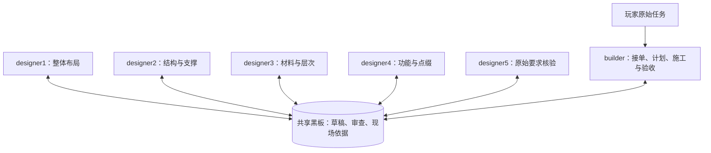

# 可选共享黑板模块：实现、使用与系统改动

日期：2026-11-21。基于 `Collabration` 分支的 `682d4f8fbb81aa13702eee2066b3268c13a615ae` 实现。

## 本次方案

增加通用、可关闭的共享黑板资源，以及独立的 `blueprint_blackboard` 工具。原 `design_blueprint` 的生成、修复、发布函数主体保持不变。黑板范式只是这项能力的一个预设用法；模块不根据预设名称或角色名称决定是否启用，也不内置“五人投票—定稿—派工”的状态机。

默认预设由 `designer1` 到 `designer5` 和一个 `builder` 组成。设计师之间、设计师与 Builder 之间均没有私信连线，信息通过黑板读写共享。Builder 是技术上的团队入口，接收玩家原始任务，负责发布已审查草稿、施工、自检和 `finish`，并不负责领导设计师讨论。



图中双向线表示资源读写，不是 Agent 之间的私信权限。

## 预设的执行过程

1. 玩家向 `builder` 提交任务。Builder 制定施工与验收计划，必要时把现场依据写入黑板；运行时发送资源可用通知，唤醒有读取权限的设计师。
2. 按 Profile，`designer1` 生成初稿；其余成员读取草稿，检查自己关注的问题。每名设计师都可以修订整份草稿，不局限于某个部件。生成或修改草稿只改变数据，不放置方块。
3. 每次修订产生新的不可变草稿 ID，保留旧版。提交时必须基于当前最新版；两名设计师同时改同一版，只会有一个提交成功，另一个需要重新读取，不能覆盖对方成果。
4. 设计师必须读取具体 `shapes`，按分页标记读完，再把审查写到 `review/草稿ID/本人名字`。内容说明 `draftId`、`approve` 和证据或具体未解决问题。新版不能沿用旧版审查。
5. Builder 读取当前草稿及本版全部审查，核对真实作者、草稿 ID 和未解决问题。五名设计师都批准同一版后，Builder 自主调用 `publish`，无需玩家发送“开始评选”或“开始施工”。
6. 发布直接使用该份草稿，不再让模型重新生成另一份蓝图。工具检查原点、几何和现场冲突；发布后获得正常施工蓝图，Builder 使用原有施工、租约、检查和验收工具完成建筑。
7. Builder 最后更新计划证据、执行 `inspect_build`，再通过原有 `finish` 验收。

**五人确认的流程由 Profile 约束，由 Agent 判断；不是工具强制统计的硬门槛。** 这保持了项目“能力由系统提供、协作约定由 Profile 表达”的做法。运行时硬性保证的是权限、版本冲突、发布资格、施工范围以及返修保留约束。若以后要求模型无法跳过五人确认，需要另外批准增加工作流校验，不能把当前实现描述成已有强制投票机制。

## Builder 发现设计问题时

移动、施工顺序等执行问题仍由 Builder 自己处理。确需改设计时：

1. 调用 `blueprint_blackboard(operation=request_revision, brief=具体问题)`。
2. 记录现场中符合当前蓝图的已建非空气格子，释放本入口的施工租约；此后运行时拒绝继续改方块或结束工程。
3. 设计师从黑板读取问题、已发布草稿与分页的 `protected` 坐标，生成修订。修订不能删除已保留格子，也不能改变其材质。
4. 所有人审查新版后，由 Builder 发布新版，重新检查现场，从当前剩余格子继续建造；不会清空现场、重新启动工程。

如果必须拆掉已建部分才能满足原始要求，当前实现会拒绝该修订，需要报告冲突。这与本轮确认的“保留已经建好的部分”一致。

## 新增工具

| 工具 | 用途 | 关键参数 |
| --- | --- | --- |
| `read_blackboard` | 读取原始目标、成员、条目、草稿摘要及指定草稿的实际几何 | `sinceRevision`、`prefix`、`draftId`、`offset`、`limit` |
| `write_blackboard` | 发布现场依据、审查或其他共享事实 | `key`、`content`、`expectedRevision` |
| `wait_for_blackboard` | 挂起模型请求，等待新资源版本 | `sinceRevision`；必须单独调用 |
| `blueprint_blackboard` | 独立的草稿生成、修订、发布与施工返修工具 | `operation`、`brief`、`baseDraftId`、`draftId` |

`operation` 有四种：

- `draft`：生成首版草稿，不发布施工蓝图。
- `revise`：根据 `baseDraftId` 和修改要求生成新草稿。
- `publish`：工程入口发布指定的当前草稿，要求已有计划；设计师不能发布。
- `request_revision`：由工程入口登记施工返修及已建保留约束。

`expectedRevision` 是**该条目的版本号**，不是整个黑板版本；创建新条目默认填 0。重复提交相同内容不会制造新版本和唤醒风暴。`sinceRevision` 过滤条目，不过滤草稿；草稿几何看 `draft.nextOffset`，返修坐标看 `protected.nextOffset`。默认每页 32 项，最多 128 项。

首版保留最多 512 个条目、4096 次写入记录、32 版草稿。达到上限会返回明确错误，不静默丢弃历史，也不自动宣布已经达成共识。

## 启用和日常测试

在实际项目目录运行：

```powershell
npm run console
```

默认地址为 `http://127.0.0.1:8787`，环境变量 `CONSOLE_PORT` 可以覆盖。

1. 旧控制台进程需要重启，浏览器刷新后再使用新增功能。
2. 在“团队工坊”选择“共享黑板”。默认载入五名设计师和一个 Builder，并启用共享黑板模块。
3. 检查六名成员使用的 Profile 和模型配置，确认“控制”页端口是本次 Minecraft 对局域网开放的端口。
4. 选择“保存并开始新工程”，在游戏里向 `builder` 发出一个简单目标。旧黑板预设的人数和权限不同，不应直接用新模板恢复旧工程。
5. 在“启动与日志”和游戏聊天中观察真实黑板读取、写入、草稿发布和返修操作；在团队页“共享黑板”面板展开当前草稿及审查内容。展开状态会在定时刷新时保留。

若自建团队，只要保存下面的开关，并在每名成员的 `permissions.allow` 中明确列出其需要的工具，就可以使用相同资源，无需选中黑板预设：

```json
{
  "modules": { "blackboard": { "enabled": true } }
}
```

新工具采用显式授权：只有 `allow: ["*"]` 不会自动获得黑板权限。关掉模块后，新工具不可执行。未启用黑板的其他预设和普通单 Agent 不会获得这些工具。仅打开模块也不会授予私信连线；自建团队若保留直连关系，其通信方式仍由关系、权限和 Profile 决定。

## 需要上报的系统接入改动

这次有系统接入改动，并非只修改 Profile。

| 文件 | 改动范围 |
| --- | --- |
| `src/building/blackboard.js`（新增） | 通用资源状态、显式授权、条目版本、分页、摘要和保留坐标读取；没有角色人数和审查决策逻辑 |
| `src/building/blueprint-blackboard.js`（新增） | 独立的模型草稿提示词、生成与错误修复、几何校验、精确发布、返修；不调用原蓝图 Skill |
| `src/building/blackboard-runtime.js`（新增） | 在现有事务中执行资源 RPC；持久化不可变草稿、冲突检查和资源变更通知 |
| `action-protocol.js`、`native-actions.js`、`tools.js` | 注册四个工具的参数、说明、权限与调用入口；协调回合只额外开放获授权的黑板操作和建材查询 |
| `team-client.js`、`team-runtime.js` | 新 RPC 和资源摘要、通知；返修期间拒绝施工和 finish；普通任务调度机制保持原有方式 |
| `loop-agent.js` | 注入独立设计器；把资源更新接入原有协调回合和挂起／唤醒机制，处理等待边界的事件竞争 |
| `decision-context.js`、`progress.js` | 按开关和权限提供工具及资源指令；读取新的资源版本算新事实，重复读取不算进展 |
| `team-state.js` | 新预设及 `PRESET_INSTRUCTIONS.blackboard`；允许共享资源形成协作连接，但不赋予私信权限；入口可使用新增发布工具 |
| `console/index.html` | 模块开关、显式权限编辑、六成员资源图、当前草稿和审查记录面板、手机布局 |
| `console/team-supervisor.js`、`console/team-transcript.js` | 恢复工程时核对模块配置；向玩家展示实际资源操作，不虚构 Agent 私信 |

共享数据保存在现有 `bots/team-runtime.sqlite` 工程状态中；没有新增数据库服务或第三方依赖，也没有把共享黑板塞进每个 Agent 的长期对话记忆。模型按需读取草稿和条目，决策上下文只放紧凑摘要。原有个人 memory 管理没有重新设计。

已与 Git 原版逐段核对：`tools.js` 中原 `async useSkill(...)` 函数主体、`planner.js`、`skills/design-blueprint/SKILL.md` 和 `decision-context.js` 中的原 `CORE` 内容不变。系统新增独立路径，复用已有几何编译、现场检查和建材辅助函数；“没有改原函数”不等于“没有接入系统”。个人 API 配置未调整，本次未提交或推送 Git。

## 验证和范围

- `npm run test:blackboard`：通过。覆盖关闭／显式权限、无私信共享、并发版本冲突、持久化恢复、不可变草稿、现场冲突、精确发布及中断恢复、保留已建部分的返修、六个真实 Loop/Client 的离线完整流程。
- `npm run test:team`：通过。覆盖原有通信、团队权限、并行施工、任务共享、关系预设、迁移、跨进程施工恢复、生命周期、协调等待和恢复。
- `node scripts/test-decision-context.mjs`：通过。
- `npm run test:console-ui`：通过。覆盖预设加载／保存、开关、显式权限保留、草稿和审查显示、刷新时保持展开、桌面／手机布局及切换预设清除旧模块配置。
- `node scripts/test-building-loop.mjs`：仍在第 79 行失败，期望 `completed`，实际 `blocked`。只读加载 Git 原版也在同一处失败：原有 finish 权限校验在没有团队时不授予 `finishGate`。此次未扩大范围去修改它。

最初的黑板完整流程测试使用脚本模型和模拟世界，但实际经过六个 Agent 的循环、客户端、运行时和工具入口；它证明框架通路，不代表真实模型一定会给出好的建筑或稳定达成五人共识。最初交付未进行 Minecraft 实测；后续真实联机复测见下节。

## 真实联机复测与卡住修复（2026-11-21）

联机测试保留已有工程和已建方块，以三层金字塔作为验证用例。

初次卡住时黑板 v0、没有草稿。designer1、3、5 各重复读取空板七次，触发空转保护；其余成员挂起等待。模型已获得工具和完整 Profile，但仍同时收到普通协调回合的“等待正式任务”及 `nextStep` 中的“禁止写入”，与直接参与共享设计冲突。

本轮新增修复限定在启用新工具、且不使用原 `design_blueprint` 的共享设计路径：

- 根据当前工具权限选用共享设计的回合说明、施工顺序和 `nextStep`，不再要求数据设计先取得施工委托。原 `CORE` 常量不变，原范式仍使用原说明。
- 为原生函数补全 `read_blackboard`、`write_blackboard` 的说明，明确只有 `publish` 和 `request_revision` 是入口专属；设计师可以直接 `draft`、`revise`。
- Profile 明确首稿责任，以及“独立审查，无须先等别人批准；读完就提交自己的审查；没有新事实就等待”。
- 新增黑板工具自己的草稿分页读取回执，随本任务保存并在上下文中显示已读取数量；新分页算新事实，重复页不增加覆盖率。这是模块内读取状态，不是重写通用 memory 系统。
- 入口重复查询未变化黑板时，沿用现有事件挂起机制等待更新，不再把等设计师的正常过程升级为整个工程失败；没有增加强制审批计数或自动派工。
- 草稿读取提供编译后的世界 `bounds` 和相对坐标标记，帮助区分蓝图相对坐标与世界坐标。
- 黑板施工成员首次取得部件租约计为取得了新的施工能力；单纯续期不算进展。Profile 明确认领后直接执行放置建议，避免反复认领。此进展分支仅在存在黑板上下文时启用。

真实模型验证结果：designer1 创建草稿 本地验证记录；designer1–5 均真实写入同版 `approve=true` 审查；Builder 随后发布同一草稿，施工蓝图 v1，共 7 个部件、1186 个目标格子，黑板 v7。没有人工填入批准或完工结果。

发布后 Builder 已完成设计、审查和发布步骤，取得施工清单；联机验证也覆盖了 API 请求失败后的暂停与恢复，保留蓝图和已建方块。

恢复后已实际执行两批 `place_rectangle`，每批 225 格，均返回 `status=completed`、`verified=225`。原工程总计 450 次放置、450 格确认落块，剩余 736 格。过程中一次带三维厚度的矩形调用被原工具拒绝，模型随后改成合法平面放置；没有修改原放置工具的检查。

本轮框架验证已覆盖真实设计、五人审查、精确发布及实际施工。**没有声称完成整座建筑或 finish 验收**。两批放置成功后，通过游戏正常“暂停建造”指令保存原工程，运行时为 `active + paused=true`，Builder 为 `paused`。草稿、五条审查、蓝图 v1、原点、计划和 450 格现场均保留。

上述 450 格工程当时保存为暂停状态，后续由用户开始新测试而归档；它不等于下一节已经完成收尾的 82 格新工程。游戏重新开放 LAN 后应使用新的实际端口。


## 验收完成后仍报失败：收尾修复与复测

另一组独立的三层金字塔测试使用 82 格蓝图，与前述 1186 格工程区分验证。

故障时 82/82 格已核验，4/4 部件完成、remainingCells=0；计划最后的 `verify` 步骤仍是 running。模型没有尝试 `finish`，而是反复 `inspect_build`。最后六次重复检查触发空转保护，入口工程因此变为 failed。动态 `nextStep` 当时仍提示“按蓝图施工并核验”，没有切换到收尾阶段；计划把“验收并 finish”合在一起，也容易形成先完成步骤才能 finish、又把 finish 当作步骤完成条件的循环。

修复范围：

- 仅在共享蓝图路径且成员具有真实 `finishGate` 时，按施工清单、当前蓝图版本、全场核验结果和计划状态选择收尾提示。
- 无剩余方块但缺少本版全场核验时，提示先执行一次 `inspect_build`。
- 本版全场核验成功、仍有未完成计划步骤时，提示依据实际证据更新对应步骤；不能把真正未满足的条件直接标 done。
- 核验及全部步骤都完成后，提示下一动作单独调用 `finish`，并填写原始需求的 `requirementReview`。
- Profile 明确验收步骤可以凭已取得的现场证据先完成，`finish` 是随后的独立提交动作；没有新增自动完工、自动填写批准或绕过验收的路径。

原 `finish` 实现保持不变：仍独立检查权限、现场全部差异、所有部件、计划 done 状态及原始需求证据。原空转保护也保持不变。

测试新增了真实结束状态的回归：从“清单完成但未重新核验”，推进到“核验成功但计划未完成”，再到“允许提交 finish”。同时验证旧版本核验、现场差异及设计返修状态不能进入完成提示；六 Agent 离线集成测试也断言这三个阶段的提示。

联机复测保留原 82 格、原蓝图、五人审查和 `verify=running`，只恢复误判失败的工程运行状态并重载修复。模型随后真实执行：`inspect_build`（82/82、零差异）→ `update_plan`（自行将 verify 标 done，附现场证据）→ `finish`（提交原始需求验收）。最终工程与 Builder 均为 `completed`，没有新增或拆改方块，也没有人工把工程标成 completed。

收尾修复前的工程、任务和日志备份位于暂存目录的 `finish-recovery-backup`；联机最终结果保存在 `finish-live-result.json`。黑板集成、决策上下文和原团队回归检查通过，原蓝图函数、规划器、CORE 常量及另外九种预设仍与 Git 原版一致。
